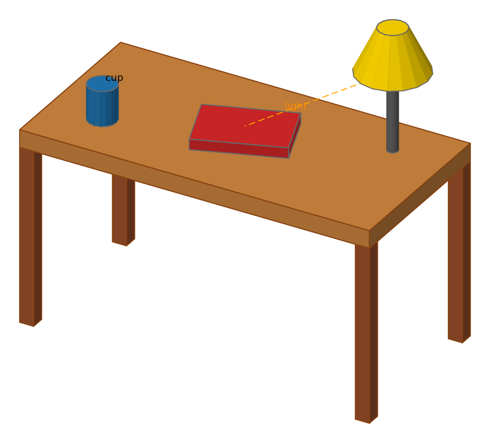

.. image:: https://github.com/asteppke/minigeo/actions/workflows/python-app.yml/badge.svg
   :alt: pytest
   :target: https://github.com/asteppke/minigeo/actions/workflows/python-app.yml

=======
minigeo
=======

A small Python library for describing and drawing basic 3D geometry, in the spirit of TikZ:
place boxes, cylinders, lines and axes relative to each other with named anchors, then draw
the scene as an SVG vector image, with matplotlib, or interactively in the browser with plotly.
It is meant for sketches and for understanding 3D geometry, readable first, fast second.

Features
--------
- **Geometry**: points, lines, axes, polygons, rectangles, circles, boxes, cylinders and cones.
- **Transforms**: translation, rotation (about any axis and any point), scaling and shear as
  composable 4x4 matrices: ``t @ shape``, ``t1 @ t2``.
- **Own axes**: every shape has a pose with its own perpendicular axes x', y', z' that turn
  with it; ``shape.rotate("x'", 30, about="center")``.
- **Anchors**: named points such as ``"top"``, ``"bottom front left"`` or ``"near end"``, and
  ``place(anchor, at=point)`` to put things next to each other.
- **Scenes and styles**: geometry is independent of drawing; a ``Scene`` adds colors, opacity,
  dashes, arrows and labels.
- **Backends**: SVG (vector drawings), matplotlib (3D axes) and plotly (interactive, WebGL),
  all with the same camera; scenes show themselves in Jupyter.

A first scene
-------------
.. code-block::

   from minigeo import Scene, Style
   from minigeo.geometry import BaseBox, BaseCylinder, BaseLine

   wood = Style(fill="peru", stroke="saddlebrown")

   scene = Scene()
   table = scene.add(BaseBox([0, 0, 1], dimensions=[2, 1, 0.1], anchor="bottom"), wood)

   # anchors are named points: the cup stands near the front left corner of the tabletop
   cup = scene.add(BaseCylinder(table.anchor("top front left") + [0.3, 0.3, 0], dimensions=[0.08, 0.2]),
                   fill="C0", label="cup", label_at="top")

   # place() moves a shape so that one of its anchors sits on a point
   book = scene.add(BaseBox([0, 0, 0], dimensions=[0.5, 0.35, 0.06]), fill="C3")
   book.rotate("z'", 20, about="center")
   book.place("bottom", at=table.anchor("top"))

   scene.add(BaseLine(cup.anchor("top"), book.anchor("top")), stroke="gray", dash="dashed")

   scene                                      # in Jupyter: shows itself as SVG
   scene.render("svg").save("table.svg")      # a vector drawing
   scene.render("matplotlib")                 # 3D axes
   scene.render("plotly").show()              # interactive in the browser

All backends take the same view options: ``elev``, ``azim`` and ``vertical_axis``
(e.g. ``vertical_axis="x"`` when x points up).

Geometry and transforms
-----------------------
.. code-block::

   from minigeo.geometry import BaseBox, Transform

   box = BaseBox([0, 0, 0], dimensions=[1, 2, 3])        # width, length, height
   Transform().translate([1, 0, 0]) @ box                 # transforms change the shape and return it
   box.rotate("z", 45, about="center")                    # rotate in place around its own center
   box.rotate("x'", 30, about="center")                   # ... or around its own x' axis

   turn_then_move = Transform().translate([0, 0, 1]) @ Transform().rotate("z", 90)

Anchor words refer to a shape's own axes: left/right (x'), front/back (y'), bottom/top (z').
After rotating a shape, ``shape.anchor("top")`` is still the middle of its own top face.
Lines use TikZ's positions (``"start"``, ``"near start"``, ``"midway"``, ``"near end"``,
``"end"``, or a number), and groups (``GeometryGroup``) have anchors on their bounding box.

Styles
------
``Style(fill=..., stroke=..., opacity=..., line_width=..., dash=..., arrow=..., text_color=...)``
holds only what is set and combines with ``|``: ``wood | Style(opacity=0.5)``. Pass a style or
single fields to ``scene.add``; single faces can be styled with ``face_styles={"top": Style(fill="gold")}``,
and ``scene.label(shape, "text", at="top")`` adds further labels that follow the shape.

For orientation, ``scene.add(shape, frame=True)`` draws the shape's own axes x', y', z' as
arrows that turn with it, and ``scene.add_frame()`` draws the world axes x, y, z at the
origin (or ``scene.add_frame(point)`` anywhere else).

Animations
----------
``scene.animate(update, frames)`` draws the scene, then calls ``update(i)`` before each further
frame, for example to turn a box a little:

.. code-block::

   scene.animate(lambda i: box.rotate("x'", 10, about="center"), frames=36)          # plotly
   scene.animate(lambda i: box.rotate("x'", 10, about="center"), frames=36,
                 backend="matplotlib")                                                  # matplotlib

With plotly you get a play button and a slider, and the animation also runs in an exported
HTML file. With matplotlib it plays live under ipympl (``%matplotlib widget``) and otherwise
shows as an HTML player in Jupyter; ``.save("turn.gif")`` writes a GIF.

Installation
------------
Clone the repository and install it with the backends you want (``mpl``, ``svg``, ``plotly``),
or all of them:

.. code-block:: bash

    pip install ".[all]"

For development (tests and linting):

.. code-block:: bash

    pip install -e ".[dev]"
    pytest
    ruff check .

Examples
--------
- ``examples/getting_started.ipynb``: a tour of geometry, transforms, anchors, scenes and the three backends.
- ``examples/animations.ipynb``: a box turning around its own axis, animated with plotly and matplotlib.
- ``examples/Cristallina.ipynb``: a sketch of an X-ray scattering experiment, with x pointing up.
- ``examples/table_scene.py``: the scene from the picture above, built entirely with anchors.

Contributing
------------
Contributions are welcome! Please feel free to submit a pull request or open an issue for any
enhancements or bug fixes.
