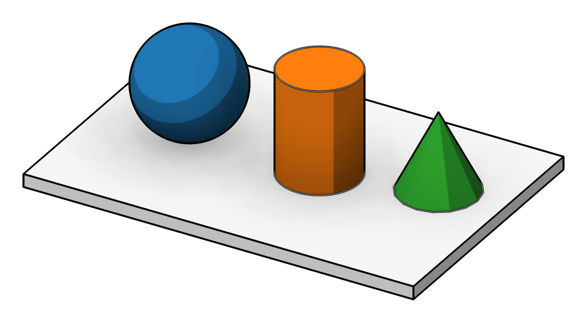

.. image:: https://github.com/asteppke/minigeo/actions/workflows/python-app.yml/badge.svg
   :alt: pytest
   :target: https://github.com/asteppke/minigeo/actions/workflows/python-app.yml
.. image:: https://app.readthedocs.org/projects/minigeo/badge/?version=latest
   :target: https://minigeo.readthedocs.io/en/latest/
   :alt: Documentation Status
.. image:: https://mybinder.org/badge_logo.svg
   :alt: Try it on Binder
   :target: https://mybinder.org/v2/gh/asteppke/minigeo/HEAD?labpath=examples%2Fgetting_started.ipynb
.. image:: https://colab.research.google.com/assets/colab-badge.svg
   :alt: Open in Colab
   :target: https://colab.research.google.com/github/asteppke/minigeo/blob/main/examples/getting_started.ipynb

=======
minigeo
=======

A small Python library for describing and drawing basic 3D geometry, in the spirit of TikZ:
place boxes, cylinders, lines and axes relative to each other with named anchors, then draw
the scene as an SVG vector image, with matplotlib, or interactively in the browser with plotly.
It is meant for sketches and for understanding 3D geometry, readable first, fast second.

The `manual <https://minigeo.readthedocs.io/en/latest/manual/index.html>`__ introduces the
ideas one at a time, with every picture next to the code that draws it.

Features
--------
- **Geometry**: ``Point``, ``Line``, ``Axis``, ``Polygon``, ``Rectangle``, ``Circle``, ``Box``,
  ``Cylinder``, ``Cone`` and ``Sphere``, with named sizes: ``Cylinder(position, radius=0.5, height=2)``.
- **Curves and meshes**: ``Polyline`` and ``Curve`` (any function of ``t``, e.g. a helix), and
  ``Mesh`` for any faces; read and write OBJ and STL files with numpy only.
- **Measuring**: ``Vector`` (with dot and cross products), ``Plane`` (distances, projections,
  intersections), ``Angle`` arcs and ``Dimension`` lines, as in technical drawings.
- **Transforms**: translation, rotation (about any axis and any point), scaling and shear as
  composable 4x4 matrices: ``t @ shape``, ``t1 @ t2``.
- **Own axes**: every shape has a pose with its own perpendicular axes x', y', z' that turn
  with it; ``shape.rotate("x'", 30, about="center")``.
- **Anchors**: named points such as ``"top"``, ``"bottom front left"`` or ``"near end"``, and
  ``place(anchor, at=point)`` to put things next to each other.
- **Frames and joints**: chains of parts that carry each other, such as an XYZ stage or a
  diffractometer, moved by sliding and turning joints: ``x.value = 0.3``.
- **Scenes and styles**: geometry is independent of drawing; a ``Scene`` adds colors, opacity,
  dashes, arrows and labels.
- **Backends**: SVG (vector drawings), TikZ (for LaTeX), matplotlib (3D axes), plotly
  (interactive, WebGL) and a ray tracer (light, shadows, exact spheres and cylinders, and
  looks for diagrams: cel shading, outlines, ambient occlusion), all with the same camera;
  scenes show themselves in Jupyter.

A first scene
-------------
.. code-block:: python

   from minigeo import Box, Cylinder, Line, Scene, Style

   wood = Style(fill="peru", stroke="saddlebrown")

   scene = Scene()
   table = scene.add(Box([0, 0, 1], size=[2, 1, 0.1], anchor="bottom"), wood)

   # anchors are named points: the cup stands near the front left corner of the tabletop
   cup = scene.add(Cylinder(table.anchor("top front left") + [0.3, 0.3, 0], radius=0.08, height=0.2),
                   fill="C0", label="cup", label_at="top")

   # place() moves a shape so that one of its anchors sits on a point
   book = scene.add(Box([0, 0, 0], size=[0.5, 0.35, 0.06]), fill="C3")
   book.rotate("z'", 20, about="center")
   book.place("bottom", at=table.anchor("top"))

   scene.add(Line(cup.anchor("top"), book.anchor("top")), stroke="gray", dash="dashed")

   scene                                      # in Jupyter: shows itself as SVG
   scene.save("table.svg")                    # or .png, .pdf (matplotlib), .html (plotly)
   scene.render("matplotlib")                 # 3D axes
   scene.render("plotly").show()              # interactive in the browser
   scene.save("table.png", backend="raytrace")  # with light and shadows
   scene.save("table.tex", width=8)           # TikZ for LaTeX, 8 cm wide

All backends take the same view options: ``elev``, ``azim`` and ``vertical_axis``
(e.g. ``vertical_axis="x"`` when x points up).

Geometry and transforms
-----------------------
.. code-block:: python

   from minigeo import Box, Transform

   box = Box([0, 0, 0], size=(1, 2, 3))                   # width, length, height (or size=1 for a cube)
   Transform().translate([1, 0, 0]) @ box                 # transforms change the shape and return it
   box.rotate("z", 45, about="center")                    # rotate in place around its own center
   box.rotate("x'", 30, about="center")                   # ... or around its own x' axis

   turn_then_move = Transform().translate([0, 0, 1]) @ Transform().rotate("z", 90)

   copy = box.copy()                                      # an independent copy

Round shapes take ``segments=`` (default 16), e.g. ``Sphere(position, radius=1, segments=32)``.
The old names (``BaseBox(position, dimensions=...)``, ``GeometryGroup``, ...) still work but give a
deprecation warning that names the replacement.

Anchor words refer to a shape's own axes: left/right (x'), front/back (y'), bottom/top (z').
After rotating a shape, ``shape.anchor("top")`` is still the middle of its own top face.
Lines use TikZ's positions (``"start"``, ``"near start"``, ``"midway"``, ``"near end"``,
``"end"``, or a number), and groups (``Group``) have anchors on their bounding box.

Vectors, planes, angles and dimensions
--------------------------------------
.. code-block:: python

   from minigeo import Angle, Dimension, Plane, Vector

   a, b = Vector([2, 0, 0]), Vector([1, 1, 0])
   a.dot(b), a.angle_to(b)                    # 2.0, 45.0
   n = a.cross(b)                             # a Vector, starting where a starts

   ground = Plane([0, 0, 0], normal=[0, 0, 1])
   ground.distance_to([1, 2, 3]), ground.project([1, 2, 3])
   ground.intersect(Vector([0, 0, -1], origin=[1, 1, 2]))

   scene.add(a, label="a")                    # vectors are arrows; labels go to the tip
   scene.add(Angle.between(a, b), label="θ")  # an arc; a right angle gets a square
   scene.add(Dimension(box.anchor("bottom front left"), box.anchor("bottom front right"),
                       offset=[0, -0.3, 0], unit=" m"))

Angles and dimension lines are drawn on top of solids, like labels, so that they stay readable.

Styles
------
``Style(fill=..., stroke=..., opacity=..., line_width=..., dash=..., arrow=..., text_color=...)``
holds only what is set and combines with ``|``: ``wood | Style(opacity=0.5)``. Pass a style or
single fields to ``scene.add``; single faces can be styled with ``face_styles={"top": Style(fill="gold")}``,
and ``scene.label(shape, "text", at="top")`` adds further labels that follow the shape.

For orientation, ``scene.add(shape, frame=True)`` draws the shape's own axes x', y', z' as
arrows that turn with it, and ``scene.add_frame()`` draws the world axes x, y, z at the
origin (or ``scene.add_frame(point)`` anywhere else).

Frames and joints
-----------------
A ``Frame`` is a coordinate system that carries other frames and geometry. A joint is a frame
whose position on its parent is set by one number: ``prismatic`` joints slide, ``revolute``
joints turn (in degrees). Build the parts as usual and attach them to the joint that carries
them:

.. code-block:: python

   from minigeo import Box, Frame, Transform

   base = Frame()
   x = base.prismatic("x", limits=(0, 0.5))      # X carries Y,
   y = x.prismatic("y")                          # Y carries Z
   z = y.prismatic("z")

   carriage = x.attach(Box([0, 0, 0], size=(0.3, 1, 0.05)))
   head = z.attach(Box(carriage.anchor("top"), size=(0.1, 0.1, 0.1), anchor="bottom"))

   x.value = 0.3     # absolute: the carriage and the head move to x = 0.3
   x.move(0.05)      # relative, along the joint's axis
   Transform().translate([0, 0.1, 0]).in_frame(x) @ head   # along x's own axes

Positions and transforms are given in world coordinates as things stand now, so anchors,
``place`` and ``Transform() @ part`` work as before; attached parts are kept relative to their
frame and move along with it afterwards.

Animations
----------
``scene.animate(update, frames)`` draws the scene, then calls ``update(i)`` before each further
frame, for example to turn a box a little:

.. code-block:: python

   scene.animate(lambda i: box.rotate("x'", 10, about="center"), frames=36)          # plotly
   scene.animate(lambda i: box.rotate("x'", 10, about="center"), frames=36,
                 backend="matplotlib")                                                  # matplotlib

With plotly you get a play button and a slider, and the animation also runs in an exported
HTML file. With matplotlib it plays live under ipympl (``%matplotlib widget``) and otherwise
shows as an HTML player in Jupyter; ``.save("turn.gif")`` writes a GIF. The ray tracer makes
an animated PNG, in any look, which plays wherever images are shown:

.. code-block:: python

   movie = scene.animate(lambda i: box.rotate("z", 20, about="center"), frames=18,
                         backend="raytrace", look="diagram")
   movie.save("turning.png")                  # or .gif, .webp

Ray tracing
-----------
``scene.render("raytrace")`` traces rays through every pixel: faces are lit by a light from the
upper left, cast shadows on each other, and transparent faces show what lies behind them.
Spheres and cylinders are hit exactly, so they are perfectly round; intersecting solids and
lines that pass through them are drawn correctly, which the SVG and matplotlib backends
(painting faces from back to front) cannot always do. Edges, lines and labels are hidden where
something lies in front of them.

.. code-block:: python

   image = scene.render("raytrace", width=1000, samples=3)   # 3 x 3 rays per pixel
   image.save("scene.png")                                    # or .jpg, .webp
   scene.render("raytrace", shadows=False, background="white")

It is written in numpy and takes about a second for a 500-pixel image. With the optional
``fast`` extra (``pip install ".[ray,fast]"``), rays are cast by compiled code from numba on all
processor cores instead: several times faster, with the same pictures. It is used whenever
numba is installed; ``engine="numpy"`` or ``engine="numba"`` chooses explicitly.

For diagrams, *looks* replace the photo-like light: ``look="cel"`` (flat bands of color and
outlines), ``look="soft"`` (ambient occlusion instead of shadows), ``look="diagram"`` (both)
and ``look="print"`` (gray tones). Single settings change on top of a look:

.. code-block:: python

   scene.render("raytrace", look="diagram", bands=2, outline_width=2)
   scene.render("raytrace", look="cel", palette=["whitesmoke", "slategray", "goldenrod"])

TikZ
----
``scene.render("tikz")`` writes the scene as a ``tikzpicture`` with plain 2D coordinates,
drawn like the SVG picture. Labels are LaTeX (``"$2\theta$"``).

.. code-block:: python

   picture = scene.render("tikz", width=8)    # centimetres
   picture.save("figure.tex")                 # \input{figure.tex}; needs \usetikzlibrary{arrows.meta}
   picture.save("figure.pdf")                 # compiled with pdflatex

Installation
------------
You can install the core minigeo library from PyPI using:

.. code-block:: bash

    pip install minigeo 

which only installs the library itself and the required numpy dependency. 

For the full installation with all optional extras, use:

.. code-block:: bash

    pip install "minigeo[all]"

which installs the matplotlib, svg, plotly and ray tracing backends, as well as the optional fast ray tracer with numba.
Individual parts can be selected by specifying the desired extras instead of ``all``.

.. code-block:: bash

    pip install "minigeo[mpl,svg,plotly,ray,fast]"

The development version can be installed from this repository. Clone it and install with the desired the backends you want (``mpl``, ``svg``, ``plotly``,
``ray``), or all of them, and optionally ``fast`` for a faster ray tracer (numba):

.. code-block:: bash

    pip install -e ".[mpl,svg,plotly,ray,fast]"

For development (tests, linting and the documentation):

.. code-block:: bash

    pip install -e ".[dev]" -r docs/requirements.txt
    pytest
    ruff check .
    sphinx-build -b html docs docs/_build/html    # the API reference, from the docstrings

Examples
--------
Try the examples in your browser, without installing anything: Binder starts a JupyterLab
with everything installed (it takes a minute), Colab installs minigeo in the first cell.

.. list-table::
   :header-rows: 1
   :widths: 30 50 10 10

   * - Notebook
     - Shows
     - Binder
     - Colab
   * - ``examples/getting_started.ipynb``
     - geometry, transforms, anchors, scenes, the three backends, measuring
     - `launch <https://mybinder.org/v2/gh/asteppke/minigeo/HEAD?labpath=examples%2Fgetting_started.ipynb>`__
     - `open <https://colab.research.google.com/github/asteppke/minigeo/blob/main/examples/getting_started.ipynb>`__
   * - ``examples/animations.ipynb``
     - a box turning around its own axis, with plotly and matplotlib
     - `launch <https://mybinder.org/v2/gh/asteppke/minigeo/HEAD?labpath=examples%2Fanimations.ipynb>`__
     - `open <https://colab.research.google.com/github/asteppke/minigeo/blob/main/examples/animations.ipynb>`__
   * - ``examples/joints.ipynb``
     - frames and joints: a hinge, a serial XYZ stage and a θ–2θ scan, animated
     - `launch <https://mybinder.org/v2/gh/asteppke/minigeo/HEAD?labpath=examples%2Fjoints.ipynb>`__
     - `open <https://colab.research.google.com/github/asteppke/minigeo/blob/main/examples/joints.ipynb>`__
   * - ``examples/Cristallina.ipynb``
     - a sketch of an X-ray scattering experiment, with x pointing up
     - `launch <https://mybinder.org/v2/gh/asteppke/minigeo/HEAD?labpath=examples%2FCristallina.ipynb>`__
     - `open <https://colab.research.google.com/github/asteppke/minigeo/blob/main/examples/Cristallina.ipynb>`__

``examples/readme_image.py`` draws the pictures of this page; ``examples/table_scene.py`` builds a
room scene entirely with anchors;
``examples/xyz_stage.py`` builds and animates the XYZ stage.

Contributing
------------
Contributions are welcome! Please feel free to submit a pull request or open an issue for any
enhancements or bug fixes.
